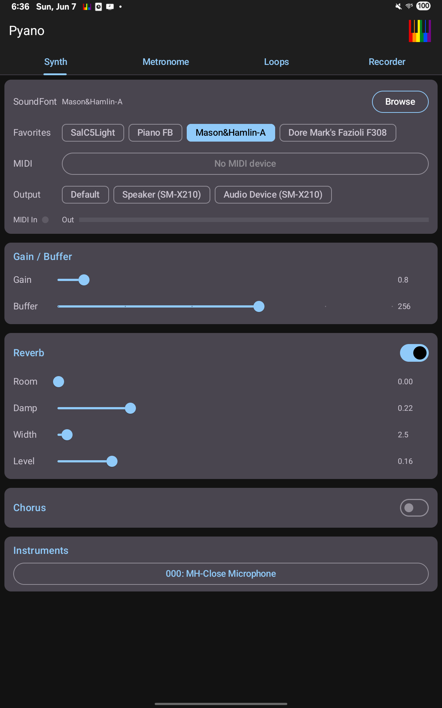
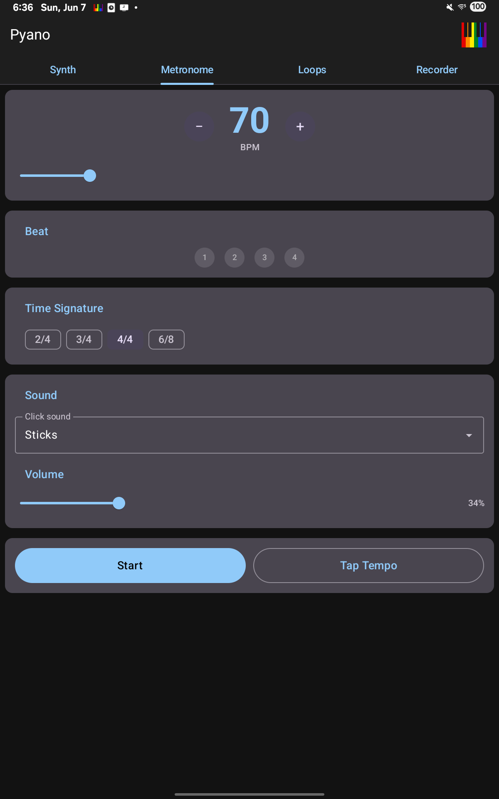
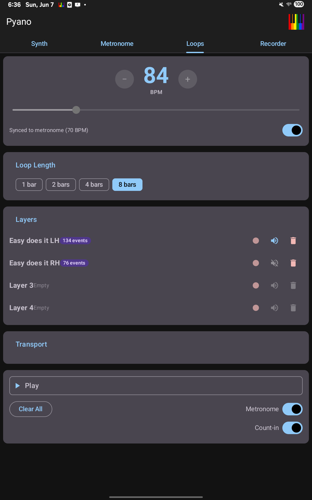
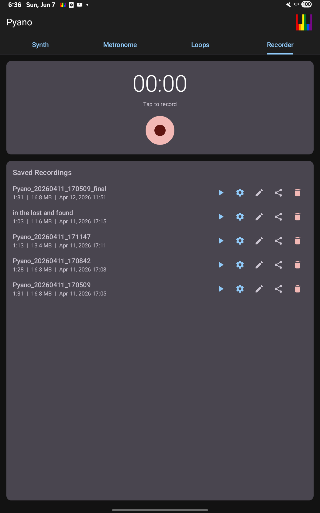
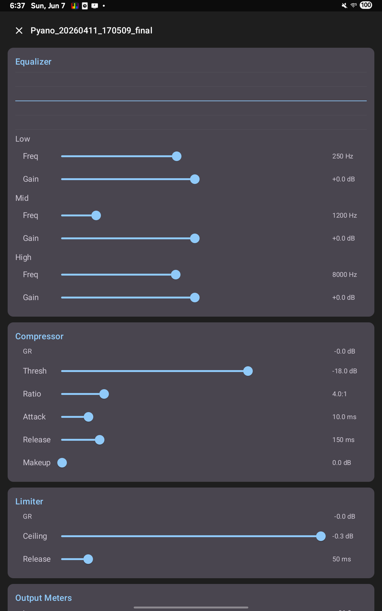

<!-- Concern: introduces Pyano and build requirements | Non-concern: feature planning | IO: none -->
# Pyano

An Android MIDI-to-SoundFont synthesizer and mobile music workstation — turn a MIDI keyboard into a real instrument, with a metronome, loop station, recorder, and mastering suite.

> _This repo was generated entirely by Claude._

## Screenshots

<table>
  <tr>
    <td align="center"><br>Synth</td>
    <td align="center"><br>Metronome</td>
    <td align="center"><br>Loop Station</td>
    <td align="center"><br>Recorder</td>
    <td align="center"><br>Mastering</td>
  </tr>
</table>

## Features

- **Synth** — touch keyboard and live MIDI (USB host) into FluidSynth, with a
  SoundFont browser and an effects panel.
- **Metronome** — BPM control with audible click.
- **Loop Station** — multi-layer MIDI looper: per-layer record/overdub, mute,
  rename, and persisted loops across sessions.
- **Recorder** — captures audio to PCM and exports `.wav`.
- **Mastering** — a stereo DSP chain: 3-band parametric EQ (RBJ biquads),
  envelope-follower compressor, and a brick-wall lookahead limiter.
- Native low-latency audio through **Oboe**; a robust hand-written MIDI parser;
  a foreground media service for background playback.

## Tech stack

| Area | Android app |
| --- | --- |
| Language | Kotlin 2.0.0 + C/C++ (C17 / C11) |
| UI | Jetpack Compose (Material 3) |
| Synth core | FluidSynth 2.3.3 (native `.so`) |
| Audio I/O | Oboe 1.9.0 |
| MIDI | Android MIDI API + custom parser |
| Build | Gradle 8.9, AGP 8.5.0, NDK + CMake 3.22.1 |
| Targets | SDK 26+ (min/target/compile 26/35/35), JVM 17 |

## Architecture

```
ui/ (Compose tabs)
      │
      ▼
PyanoViewModel ──► midi/ (device mgr + event parser)
      │
      ▼
audio/ (FluidSynthEngine, LoopEngine, AudioRecorder, MasteringEngine)
      │  JNI
      ▼
cpp/ (native-lib.c, audio-engine.cpp) ──► Oboe (RT callback) + FluidSynth
```

The synthesis core is FluidSynth loading a `.sf2` SoundFont, mixed out through
Oboe's lowest-latency audio path.

## Build & Run

See [build requirements and commands](docs/build.md).

## Tests

```bash
# Android: JVM unit tests
cd platform_android && ./gradlew testDebugUnitTest
```

See [local recording sync](local-sync/README.md) for MIDI capture and manual uploads.

## Source map

Run `annotated-tree --hidden --include-tests .` to explore file responsibilities.
See [source checks and commit gates](docs/quality.md).

## License & attribution

Pyano is released under the [MIT License](./LICENSE) — Copyright (c) 2026 Ryan Cox.

Third-party components Pyano uses (including ones not committed to this repo, such
as the FluidSynth libraries and the SoundFont) are documented, with their licenses
and obligations, in [THIRD_PARTY_NOTICES.md](./THIRD_PARTY_NOTICES.md). In
particular, FluidSynth is **LGPL-2.1** and no SoundFont is bundled.

Author: **Ryan Cox** — <https://github.com/ryanedwincox>
